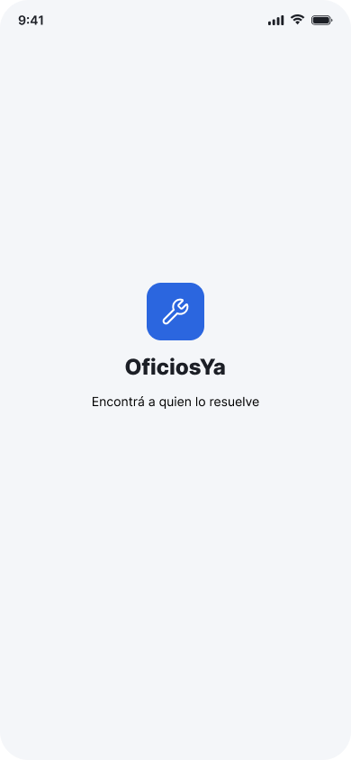
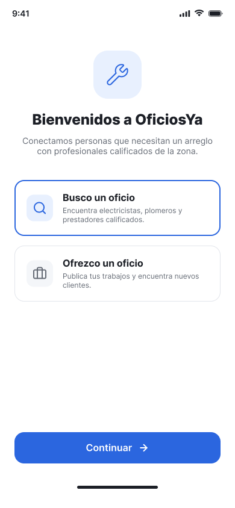
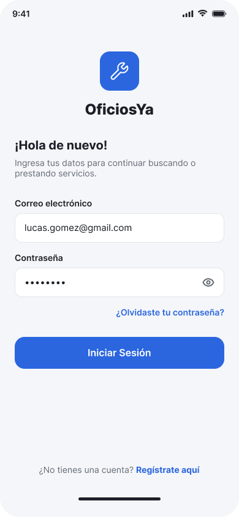
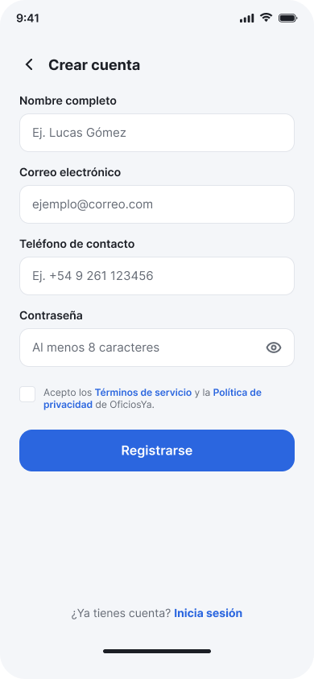
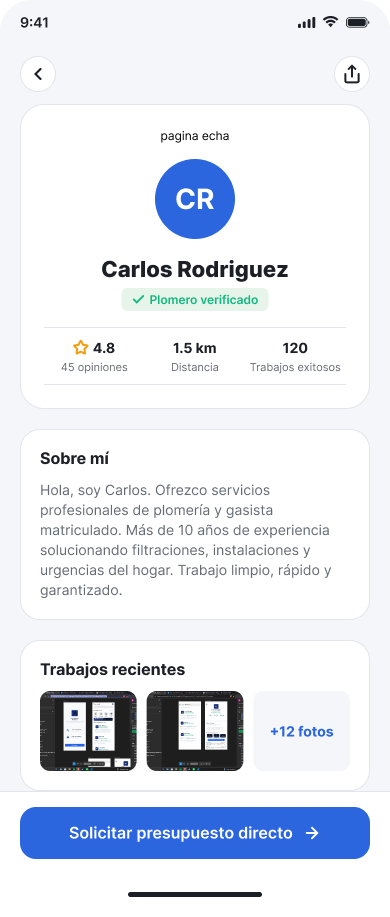
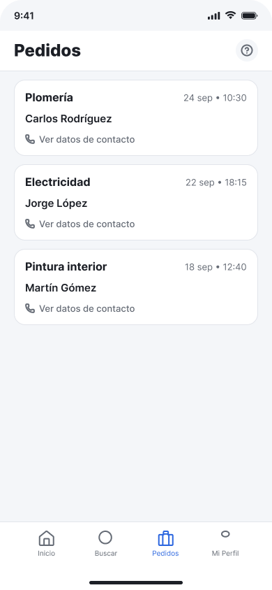

# OficiosYa

## Evaluacion Global Integradora

**Carrera:** Tecnicatura Universitaria en Desarrollo de Software  
**Espacio curricular:** Programacion de Aplicaciones para Celulares  
**Estudiante:** Brandon Luna 
**Repositorio:** https://github.com/BrandonLunaCastro/OficiosYA

---

# I. Planteamiento y justificacion del problema

## Problema real

En la provincia de Mendoza, muchas personas necesitan contratar servicios de plomeria, electricidad, mecanica, pintura, gas u otros oficios. Sin embargo, la busqueda suele depender de recomendaciones informales, mensajes privados o publicaciones dispersas. Esto dificulta comparar prestadores, conocer su ubicacion, verificar su reputacion y guardar de forma organizada las solicitudes realizadas.

El problema es concreto: un cliente necesita encontrar rapidamente un profesional cercano y confiable, mientras que un prestador independiente necesita publicar sus servicios y construir una reputacion digital que le permita conseguir nuevos trabajos.

## Usuario destinatario

**Cliente:** personas que necesitan contratar una solucion domiciliaria. Principalmente, usuarios que buscan velocidad, cercania y referencias antes de decidir. El perfil representativo es Martin Gonzalez, empleado administrativo de 28 años, que necesita localizar un profesional cercano y solicitar un presupuesto.

**Prestador:** profesionales independientes de Mendoza que ofrecen servicios domiciliarios. El perfil representativo es Carlos Rodriguez, plomero y gasista independiente de 42 años, que necesita mostrar su experiencia, ubicacion, datos de contacto, servicios y valoraciones.

## Justificacion

OficiosYa responde a un problema real, propio. La aplicacion sirve como intermediario de informacion entre ambas partes sin depender de una conversacion aislada para comenzar la busqueda.

El usuario puede:

- explorar categorias de oficios;
- buscar por texto, categoria, valoracion y distancia;
- consultar un perfil profesional;
- solicitar un presupuesto;
- consultar los pedidos creados durante la sesion;
- ver los datos de contacto del prestador;
- editar el perfil propio;

El prestador puede:

- elegir su rol y completar el perfil inicial;
- editar su informacion profesional;
- agregar y modificar servicios;
- informar su ubicacion y datos de contacto;
- consultar su perfil, contacto y valoraciones.

La solucion transforma una busqueda informal en un recorrido claro dentro de la aplicacion: elegir, comparar, consultar y solicitar.

---

# II. Diseno de la aplicacion

## Flujo de navegacion

```text
                         INICIO DE LA APLICACION
                                  |
                             [Splash]
                                  |
                            [Onboarding]
                                  |
                           [Inicio de sesion]
                            /              \
                    Cuenta cliente      Cuenta prestador
                            |                    |
                    [Inicio cliente]     [Perfil profesional]
                 /          |          \      /      |      \
         [Busqueda]  [Pedidos]  [Editar] [Servicios] [Pedidos] [Contacto] [Resenas]
               |                            |
       [Resultados + filtros]          [Agregar o editar]
               |
       [Perfil del prestador]
               |
    [Solicitar presupuesto]
               |
          [Confirmacion]
               |
          [Pedido guardado]
```

El flujo esta registrado centralmente en [app_router.dart](lib/routes/app_router.dart) y [app_routes.dart](lib/routes/app_routes.dart). La pantalla inicial es el Splash, declarado en [main.dart](lib/main.dart). El inicio de sesion identifica el rol y abre directamente el inicio correspondiente.

### Recorrido del usuario cliente

1. El cliente abre la aplicacion y recorre el Splash y el Onboarding.
2. Inicia sesion con una cuenta demo o una cuenta registrada en SQLite.
3. En el inicio visualiza categorias, prestadores destacados y el buscador.
4. Selecciona una categoria o escribe el nombre de un oficio.
5. Combina filtros de destacados, valoracion minima y distancia.
6. Selecciona un prestador y consulta su perfil, reputacion y servicios.
7. Pulsa **Solicitar presupuesto**, completa los datos y confirma.
8. La solicitud se guarda en SQLite y aparece en **Pedidos**.
9. Desde el pedido consulta el telefono y el correo del prestador.

### Recorrido del usuario prestador

1. El prestador inicia sesion o registra una cuenta profesional.
2. La aplicacion abre directamente **Mi perfil profesional**.
3. Desde **Editar perfil** modifica nombre, oficio y descripcion.
4. En **Servicios** agrega o modifica un servicio publicado.
5. En **Ubicacion y contacto** actualiza cobertura, telefono y correo.
6. En **Pedidos** consulta las solicitudes destinadas a su perfil.
7. Selecciona una solicitud y accede a los datos del cliente.
8. Desde el detalle puede iniciar una llamada o redactar un correo.
9. En **Resenas** consulta promedio, distribucion y comentarios.

## Pantallas clave

### Splash y onboarding

Presentan la identidad de la aplicacion y explican el funcionamiento basico antes de acceder al inicio de sesion.




### Acceso y alta de cuenta

El prototipo incluye pantallas para elegir el rol y registrarse. En la version implementada, el inicio de sesion reconoce cuentas mock y cuentas reales creadas en SQLite. El formulario de registro valida los datos, permite seleccionar cliente o prestador y guarda la cuenta en la base local.







### Inicio del cliente

Presenta categorias, prestadores destacados, buscador y navegacion inferior.


La implementacion se encuentra en [client_home_screen.dart](lib/ui/screens/client_home_screen.dart).

### Busqueda y perfil del prestador

La pantalla de resultados permite combinar texto, categoria, valoracion y distancia. Desde cada tarjeta se accede al perfil y a la solicitud de presupuesto.




Las pantallas estan implementadas en [search_results_screen.dart](lib/ui/screens/search_results_screen.dart) y [provider_profile_screen.dart](lib/ui/screens/provider_profile_screen.dart).

### Pedidos y contacto

En el flujo del cliente, los pedidos muestran el servicio solicitado, el prestador y los datos disponibles. En el flujo del prestador, **Pedidos** abre la lista **Solicitudes de contacto** con los pedidos dirigidos al perfil activo. Cada tarjeta muestra el oficio, la fecha y el cliente; al tocar **Ver datos del cliente**, se abre una segunda pantalla con su teléfono y correo para iniciar una llamada o redactar un mensaje.



La implementacion corresponde a [orders_screen.dart](lib/ui/screens/orders_screen.dart) y [contact_info_sheet.dart](lib/ui/widgets/contact_info_sheet.dart).

La lista y el detalle de las solicitudes entrantes del prestador se implementan en [provider_orders_screen.dart](lib/ui/screens/provider_orders_screen.dart). Cada pedido conserva los datos de contacto del prestador para la vista del cliente y los datos del cliente para la vista del prestador.


### Funciones del prestador

El prestador puede consultar y editar su perfil, publicar servicios, actualizar ubicacion y contacto, y revisar valoraciones.


Las pantallas se encuentran en [professional_profile_screen.dart](lib/ui/screens/professional_profile_screen.dart), [provider_services_screen.dart](lib/ui/screens/provider_services_screen.dart), [provider_contact_screen.dart](lib/ui/screens/provider_contact_screen.dart) y [provider_reviews_screen.dart](lib/ui/screens/provider_reviews_screen.dart).


Las capturas de configuracion y contacto se conservan como referencia del diseño enviado, aunque muestran el campo WhatsApp. En la version implementada, los medios de contacto del prestador son telefono y correo electronico.

## Criterio visual

- **Color principal:** azul, utilizado en acciones, iconos y elementos activos.
- **Color secundario:** verde para estados verificados y confirmaciones.
- **Resenas:** estrellas amarillas para valoraciones.
- **Superficies:** tarjetas blancas con bordes suaves y fondo claro.
- **Tipografia:** tipografias heredadas de Flutter/Material, con jerarquia por peso y tamano.
- **Iconografia:** iconos Material que representan categorias, perfil, ubicacion, pedidos y contacto.
- **Consistencia:** botones principales reutilizables, barras de navegacion inferiores, tarjetas y campos de texto compartidos.

Los componentes visuales reutilizables incluyen [primary_button.dart](lib/ui/widgets/primary_button.dart), [provider_card.dart](lib/ui/widgets/provider_card.dart), [app_bottom_nav.dart](lib/ui/widgets/app_bottom_nav.dart), [custom_text_field.dart](lib/ui/widgets/custom_text_field.dart) y [search_bar_field.dart](lib/ui/widgets/search_bar_field.dart).

## Evidencia de diseno

- Prototipo Figma: https://www.figma.com/design/sS95vL0ooCGJMachOMybxz/Untitled?node-id=0-1&t=VPQEpse0YppDxvjt-1
- Capturas de prototipo: [CapturasDiseño/Figma](CapturasDiseño/Figma/)
- Capturas ejecutadas en dispositivo o emulador: [CapturasDiseño/Dispositivo](CapturasDiseño/Dispositivo/)

---

# III. Implementacion practica

## Estado del desarrollo

La aplicacion fue desarrollada con **Flutter y Dart**. Incluye navegacion, modelos, repositorios, pantallas, widgets reutilizables y pruebas automatizadas. Utiliza SQLite para persistir cuentas, pedidos y valoraciones; las cuentas de demostracion siguen disponibles para probar rapidamente ambos roles.

## Cuentas mock para probar el inicio de sesion

El inicio de sesion reconoce primero las credenciales locales de demostracion. Si no corresponden a una cuenta reservada, consulta la base SQLite y verifica la contraseña mediante PBKDF2 con una sal aleatoria. El sistema permite registrar cuentas nuevas y cerrar sesion desde las pantallas principales.

| Rol | Correo | Contrasena |
|---|---|---|
| Cliente | `cliente@oficiosya.com` | `Cliente123` |
| Prestador | `prestador@oficiosya.com` | `Prestador123` |

Al autenticar una cuenta de cliente se abre el inicio del cliente; al autenticar una cuenta profesional se abre directamente su perfil. La seleccion de rol y el alta manual del perfil no se repiten al iniciar sesion.

## Funcionalidades implementadas

### Flujo general

- Splash y onboarding.
- Inicio de sesion con cuentas mock y validacion de credenciales.
- Carga automatica del perfil y acceso directo segun el rol de la cuenta.
- Navegacion principal mediante `MaterialApp` y rutas nombradas.

La autenticacion esta implementada en [sqlite_auth_repository.dart](lib/data/repositories/sqlite_auth_repository.dart), que conserva compatibilidad con las cuentas demo de [mock_auth_repository.dart](lib/data/repositories/mock_auth_repository.dart). La interfaz de inicio esta en [login_screen.dart](lib/ui/screens/login_screen.dart) y el registro funcional en [register_screen.dart](lib/ui/screens/register_screen.dart).

### Rol cliente

- Inicio con categorias y prestadores destacados.
- Busqueda por nombre, oficio o categoria.
- Filtros por valoracion minima y distancia.
- Visualizacion del perfil del prestador.
- Solicitud de presupuesto.
- Consulta de pedidos realizados durante la sesion.
- Edicion del perfil del cliente.
- Datos de cliente de demostracion precargados al iniciar sesion.
- Calificacion del prestador con estrellas y comentario opcional.

La logica de busqueda esta en [mock_provider_repository.dart](lib/data/repositories/mock_provider_repository.dart), y el registro de pedidos en [sqlite_order_repository.dart](lib/data/repositories/sqlite_order_repository.dart).

### Rol prestador

- Alta del perfil profesional.
- Edicion del perfil.
- Agregado y modificacion de servicios.
- Edicion de ubicacion y datos de contacto.
- Consulta de solicitudes recibidas con telefono y correo del cliente.
- Acciones para llamar al cliente o redactar un correo desde el pedido.
- Consulta de la ficha profesional.
- Consulta de promedio, distribucion y reseñas.
- Edicion de servicios y medios de contacto mediante formularios validados.

El perfil del prestador se carga al iniciar sesion; la edicion se realiza desde **Editar perfil**. Los medios publicados son telefono y correo electronico.

Las operaciones se realizan mediante interfaces de repositorio y implementaciones mock en [lib/data/repositories](lib/data/repositories/).

## Reutilizacion y organizacion del codigo

El proyecto se divide en:

```text
lib/
├── main.dart
├── routes/       # rutas y registro de pantallas
├── models/       # datos de la aplicacion
├── data/
│   ├── mocks/    # datos ficticios
│   └── repositories/ # acceso a datos mediante contratos
└── ui/
    ├── screens/  # pantallas
    └── widgets/  # componentes reutilizables
```

Los nombres de clases, archivos y metodos describen su responsabilidad. Por ejemplo, `ProviderProfileScreen`, `SearchResultsScreen`, `MockProviderServiceRepository` y `SqliteOrderRepository`.

Los repositorios permiten reemplazar las implementaciones mock por una base de datos sin modificar las pantallas que dependen de sus contratos. Esto separa la interfaz, los datos y la logica.

## Persistencia y datos

La persistencia usa SQLite para cuentas, pedidos y valoraciones, mediante [app_database.dart](lib/data/database/app_database.dart). Los demas datos mock se mantienen en memoria:

- servicios y perfiles compartidos entre pantallas;
- contacto profesional compartido;
- perfil del usuario en memoria.

Las cuentas registradas, pedidos y valoraciones se conservan al cerrar o reiniciar la aplicacion. Los servicios, perfiles profesionales, contacto y perfil del cliente actual siguen perdiéndose al reiniciar, porque todavía usan repositorios mock o en memoria.

## Ejecucion

```bash
git clone https://github.com/BrandonLunaCastro/OficiosYA.git
cd OficiosYA
flutter pub get
flutter run
```

Para ejecutar las pruebas:

```bash
flutter test
```

La suite cuenta con 33 pruebas verificadas, incluyendo autenticacion mock, onboarding, perfiles, pedidos, prestadores, servicios, valoraciones y contacto. La compilacion web tambien fue verificada.

## Control de calidad y GitHub

- Repositorio: https://github.com/BrandonLunaCastro/OficiosYA
- Rama principal: `main`.
- El historial incluye tareas descriptivas de estructura, repositorios, estado de pedidos y pantallas.
- El repositorio tiene acceso publico para que el docente pueda revisar el codigo.

---

# IV. Analisis critico

## Fundamentos teoricos aplicados a OficiosYa

### 1. Arquitectura de maquetado en Flutter

Flutter construye las interfaces mediante composicion: los elementos complejos se forman a partir de widgets sencillos. Por ejemplo, el perfil del prestador combina `Scaffold`, `AppBar`, `CircleAvatar`, `Row`, `Column`, `Container`, `Text`, `Icon` y botones dentro de [provider_profile_screen.dart](lib/ui/screens/provider_profile_screen.dart). La pantalla tambien reutiliza componentes como `PrimaryButton`, `ProviderCard`, `CustomTextField` y `SearchBarField`.

Cada pantalla se describe en el metodo `build(BuildContext context)`. El padre aplica restricciones al hijo, el hijo determina su tamaño dentro de ellas y el padre decide su posicion. Esta relacion explica el uso de `Expanded`, `Padding`, `Row`, `Column`, `SafeArea` y `SingleChildScrollView`: permiten distribuir o desplazar el contenido sin que se desborde en dispositivos pequenos.

### 2. Widgets estructurales e interactivos

`Scaffold` funciona como armazon principal de las pantallas; `AppBar` contiene navegacion o acciones y `body` presenta el contenido. `ListView` se utiliza para mostrar colecciones desplazables, como las solicitudes recibidas en [provider_orders_screen.dart](lib/ui/screens/provider_orders_screen.dart).

`ListTile` organiza titulo, subtitulo y accion de manera consistente. En la aplicacion, las tarjetas reutilizan esta misma idea visual para presentar el oficio, la ubicacion, la valoracion y el prestador. La propiedad `onTap` convierte la tarjeta o fila en un elemento interactivo y abre el perfil o el detalle correspondiente. Los botones usan `TextButton`, `IconButton` o `PrimaryButton` segun la importancia de la accion.

### 3. Navegacion lineal

El flujo de la aplicacion sigue principalmente un itinerario lineal: listado o busqueda -> perfil del prestador -> solicitud de presupuesto -> pedidos o confirmacion. El prestador recorre tambien una secuencia: perfil -> edicion, servicios, solicitudes, ubicacion y contacto.

Las rutas nombradas registradas en [app_router.dart](lib/routes/app_router.dart) reducen la relacion directa entre pantallas y facilitan avanzar o volver. Esta navegacion es apropiada para usuarios que quieren resolver una tarea, porque evita obligarlos a administrar un menu complejo de relaciones entre pantallas.

### 4. Usabilidad: "No me hagas pensar"

La aplicacion organiza acciones visibles y predecibles: categorias en el inicio, filtros con nombres claros, valoraciones con estrellas, estados verificados con iconos verdes y botones azules para continuar. La propiedad del usuario no depende de adivinar el significado de un simbolo.

Como regla de diseno, la pantalla debe mostrar donde se puede actuar y que ocurrira despues de tocar. La etiqueta "Solicitar presupuesto", por ejemplo, comunica mejor la accion que un generico "Enviar". Las cuentas demo tambien reducen la carga cognitiva, ya que permiten completar rapidamente la prueba de cada rol.

### 5. Restricciones del entorno tactil

En un celular no hay cursor ni estados de *hover*. Por eso los elementos accionables usan bordes, rellenos, iconos, posicion fija y cambios de estado visual. El perfil del prestador mantiene como accion principal el presupuesto; las operaciones de llamada y correo usan iconos y textos explicitos.

La menor superficie disponible exige priorizar el contenido. OficiosYa emplea `SingleChildScrollView`, barras de navegacion inferiores y tarjetas verticales para conservar una lectura clara. Los textos secundarios deben informar sin competir con el nombre del prestador, la accion principal o la ubicacion.

### 6. Modelado de datos y persistencia local

Las entidades se representan con clases Dart tipadas dentro de [lib/models](lib/models). Por ejemplo, `Provider`, `OrderRequest`, `ProfessionalProfile`, `ProviderService` y `ProviderReview` separan atributos, identificadores y datos relacionados.

La persistencia combina SQLite y repositorios mock. [app_database.dart](lib/data/database/app_database.dart) crea las tablas `accounts`, `orders` y `provider_reviews`. Los repositorios SQLite guardan cuentas con contraseña cifrada por derivación, solicitudes de presupuesto y valoraciones. Los perfiles profesionales, servicios y contacto siguen usando repositorios mock; el perfil del cliente usa memoria. Esta combinación permite validar persistencia real sin migrar por completo los datos del prototipo.

### 7. Formularios, validacion y feedback

Las pantallas de alta y edicion utilizan `Form`, claves de estado y campos controlados para recopilar datos. La clave `_formKey` permite invocar `validate()` antes de guardar y evitar registrar informacion incompleta. Los campos reutilizables definen etiquetas y pistas que orientan al usuario sobre el dato esperado.

Al iniciar sesion se verifica primero que correo y contraseña no estén vacios y despues se procesa la cuenta. El resultado se comunica con `SnackBar`: mensajes de éxito, credenciales invalidas o errores de carga hacen visibles las consecuencias de la accion sin bloquear innecesariamente toda la interfaz.

### 8. La prueba de usabilidad evalua, no crea

Una prueba de usabilidad observa a una persona resolviendo una tarea real y documenta confusiones, bloqueos y resultados. No sirve para pedir opiniones aisladas sobre el color o hacer que el coordinador explica como debe usarse la pantalla.

En la aplicacion, tareas posibles son: encontrar un plomero cerca, solicitar presupuesto, llamar al cliente desde una solicitud recibida, editar un servicio o calificar al prestador. Las dificultades observadas permitirian mejorar la navegacion y los textos sin convertir opiniones personales en cambios arbitrarios.

### 9. Prueba rapida con un solo usuario

Para este proyecto no se requiere construir primero un laboratorio costoso. Hacer una prueba temprana con una persona usuaria es preferible a no probar. El valor aumenta si se realiza antes de cerrar el diseño completo, porque permite detectar problemas estructurales mientras los bocetos siguen siendo faciles de modificar.

Una sola prueba con un inicio de sesion de cliente puede revelar si las categorias son reconocibles, si los filtros se entienden y si el usuario encuentra sin ayuda el perfil y el boton de presupuesto. Una prueba posterior con el rol prestador puede verificar pedidos, contacto, servicios y reseñas.

### 10. Protocolo de pensar en voz alta

Durante una prueba se debe pedir al participante que diga continuamente que intenta hacer, que informacion busca y que cree que sucedera al tocar. El coordinador observa, toma notas y mantiene una actitud neutral.

No debe demostrar el flujo, darle pistas ni explicar las decisiones de codigo. Si el usuario se detiene, puede preguntar: "¿Que estas buscando ahora?" o "¿Que crees que ocurrira si seleccionas este boton?". Las respuestas permiten separar un problema de interfaz real de una duda provocada por la intervencion del coordinador.

### 11. Evitar debates religiosos con datos de comportamiento

Decidir subjetivamente que un boton debe ir a izquierda o derecha, o que el azul es mejor que el verde, genera debates sin evidencia. En el diseño de una interfaz, el criterio principal es si el usuario encuentra la accion y completa la tarea sin confusión.

En OficiosYa, por ejemplo, el diseño debe evaluarse por si el usuario distingue rapidamente el perfil, los datos de contacto y el boton de presupuesto. Si una prueba muestra que confunde dos acciones, el problema se corrige con etiquetas, jerarquia o posicion, no con la opinion estética del desarrollador.

### 12. Conformidad con expectativas y tolerancia a errores

Los elementos deben mantenerse consistentes con las convenciones comunes y con el nivel de conocimiento del usuario. Los textos de accion deben anticipar el resultado y los mensajes de error deben explicar como corregirlo.

La aplicacion intenta ofrecer esta tolerancia con validaciones, estados vacios y mensajes `SnackBar`. Por ejemplo, si todavía no existen pedidos se muestra una explicacion, y si falla una operacion se conserva un mensaje claro. Falta incorporar acciones de reintento y validaciones mas completas para que el usuario siempre pueda recuperar el flujo.

### 13. Prototipado colaborativo de baja fidelidad

Antes de escribir Dart se pueden dibujar la pantalla de inicio, resultados, perfil y pedidos en papel o wireframes. El equipo las recorre como si fuera el flujo real y detecta orden de informacion, acciones principales y cambios entre pantallas.

Este tipo de prototipo facilita descartar una solucion barata, porque no requiere reconstruir código. Solo despues de validar el itinerario se implementan widgets, repositorios y pruebas, reduciendo riesgos y retrabajo.

### 14. Descubrimiento continuo y enfoque Lean

El descubrimiento continuo consiste en presentar borradores y medir el comportamiento real con regularidad. La aplicacion puede probarse con hipotesis como: "el usuario encuentra un prestador en menos pasos", "el cliente entiende el estado de su pedido" o "el prestador encuentra rapidamente una solicitud nueva".

Los prototipos permiten aprender antes de invertir en funcionalidades de gran costo, como sincronizacion remota o mensajeria. El resultado de las pruebas debe guiar iteraciones pequeñas y medibles.

### 15. Evidencia de usabilidad aplicada al proyecto

La relacion entre teoria y codigo se verifica observando recorridos completos:

1. el cliente abre la aplicacion, encuentra una categoria y selecciona filtros;
2. entra al perfil de un prestador y comprende valoracion, distancia y servicios;
3. solicita presupuesto y recibe confirmacion;
4. consulta su pedido y datos de contacto;
5. el prestador encuentra la solicitud recibida y puede iniciar llamada o correo.

Estas tareas muestran si el diseño comunica estados, acciones y resultados. Los datos que se obtienen reemplazan las discusiones esteticas por observaciones directas.

## Evaluacion tecnica integrada

## Interfaz declarativa

Flutter utiliza interfaces declarativas: el widget `Scaffold` describe su estructura y los metodos `build` describen que debe mostrarse segun el estado actual. Por ejemplo, [client_home_screen.dart](lib/ui/screens/client_home_screen.dart) combina `SearchBarField`, `CategoryItem`, `UrgencyBanner`, `ProviderCard` y `FutureBuilder`.

La ventaja es que la interfaz se define a partir de datos y estado, sin instrucciones manuales complejas para crear y modificar elementos. El costo es que el estado debe reconstruir correctamente el conjunto de widgets para no mostrar datos inconsistentes.

## Arquitectura de widgets

La aplicacion combina widgets sin estado, como `PrimaryButton`, con widgets con estado, como `SearchResultsScreen` y `OnboardingScreen`. El conjunto se organiza en pantalla y componentes reutilizables.

El repositorio central de rutas crea las pantallas e inyecta sus repositorios. De este modo, [app_router.dart](lib/routes/app_router.dart) evita que las pantallas creen directamente sus propias fuentes de datos.

Como ventaja, existe separacion entre interfaz, datos y navegacion. Como limitacion, el codigo presenta algunas pantallas extensas y podria extraerse mas logica a widgets y servicios para reducir su complejidad.

## Gestion de estado

`StatefulWidget` se usa para datos que cambian durante la navegacion:

- filtros y resultados en [search_results_screen.dart](lib/ui/screens/search_results_screen.dart);
- pagina activa del onboarding en [onboarding_screen.dart](lib/ui/screens/onboarding_screen.dart);
- navegacion inferior y perfil profesional;
- seleccion de pagina y estado de guardado.

Se utiliza `setState` para actualizar filtros, seleccion de rol, pestanas y formularios. El repositorio compartido mantiene datos profesionales y pedidos entre varias pantallas.

La ventaja es que el mecanismo es simple y apropiado para pantallas de alcance acotado. La limitacion es que no existe un estado global completo ni una solucion reactiva avanzada; al crecer la aplicacion, `setState` y repositorios singleton podrian volverse mas dificiles de coordinar.

## Asincronia

Las operaciones de repositorio utilizan `Future` y `async`:

- `getProviders()` y `searchProviders()` cargan prestadores;
- `getOrders()` obtiene pedidos;
- `createOrder()` registra una solicitud;
- `getReviews()` y `addReview()` consultan y agregan valoraciones;
- `getServices()`, `addService()` y `updateService()` administran servicios.

Las pantallas usan `FutureBuilder` para mostrar carga, datos o errores. Por ejemplo, [search_results_screen.dart](lib/ui/screens/search_results_screen.dart) mantiene un `_resultsFuture`, lo reemplaza al cambiar filtros y renderiza el resultado segun `snapshot`.

La ventaja es que las operaciones pueden representar servicios futuros sin bloquear la interfaz. La limitacion es que los repositorios actuales resuelven inmediatamente, por lo que no se simula latencia real ni recuperacion ante fallos de red. La vista de pedidos del prestador filtra las solicitudes por el nombre del perfil activo.

## Persistencia

La persistencia actual combina SQLite con datos en memoria. [sqlite_order_repository.dart](lib/data/repositories/sqlite_order_repository.dart), [sqlite_auth_repository.dart](lib/data/repositories/sqlite_auth_repository.dart) y [sqlite_provider_review_repository.dart](lib/data/repositories/sqlite_provider_review_repository.dart) usan [app_database.dart](lib/data/database/app_database.dart). En cambio, [mock_provider_service_repository.dart](lib/data/repositories/mock_provider_service_repository.dart) y [in_memory_user_profile_repository.dart](lib/data/repositories/in_memory_user_profile_repository.dart) mantienen datos solo durante la sesion.

Esta solucion permite:

- conservar cuentas, pedidos y valoraciones al reiniciar;
- compartir datos mock entre pantallas durante la sesion;
- desarrollar sin una API externa;
- mantener contratos preparados para futuras implementaciones.

Sin embargo, tiene limitaciones profesionales importantes:

- servicios, perfiles profesionales, contacto y perfil del cliente pueden perderse al reiniciar;
- las cuentas son locales y no representan autenticacion centralizada en un servidor;
- no hay respaldo remoto;
- no hay sincronizacion entre dispositivos;
- no hay actualizacion en tiempo real;
- los datos de prestadores son ficticios;
- las cuentas demo estan predefinidas y son independientes de las cuentas SQLite registradas.

## Ventajas tecnicas

- Interfaz construida con widgets reutilizables.
- Separacion por modelos, repositorios, rutas y pantallas.
- Navegacion coherente y util en ambos roles.
- Busqueda con varios criterios combinables.
- Cambios compartidos durante la sesion.
- Persistencia local SQLite de cuentas, pedidos y valoraciones.
- Registro de cuentas con seleccion de rol y validacion.
- Cierre de sesión desde el inicio y el perfil profesional.
- Solicitudes visibles para el prestador destinatario, con acceso al contacto del cliente.
- Manejo visual de carga y errores mediante `FutureBuilder`.
- Pruebas de repositorios y pantallas.
- Identidad visual consistente en la paleta, tipografia e iconos.

## Limitaciones y mejoras

1. **Persistencia:** migrar perfiles profesionales, servicios, contacto y perfil del cliente a SQLite o una API remota.
2. **Autenticacion:** agregar recuperación de contraseña, sesiones persistentes seguras y permisos.
3. **Datos:** validar datos reales de prestadores, DNI, matriculas y ubicacion.
4. **Estado:** incorporar Provider, Riverpod o BLoC si la aplicacion crece.
5. **Errores:** mejorar validaciones, estados vacios y reintentos ante fallos.
6. **Imagenes:** reemplazar miniaturas y avatares simulados por imagenes reales.
7. **Logica de contacto:** completar las acciones de llamada y correo en todos los flujos; desde los pedidos entrantes del prestador ya se pueden iniciar.
8. **Pruebas:** agregar mas pruebas de navegacion, busqueda y casos sin datos.
9. **Arquitectura:** dividir pantallas grandes y extraer validaciones y mapeos.

## Conclusion

La aplicacion demuestra la relacion entre interfaz declarativa, arquitectura de widgets, gestion de estado, asincronia y persistencia dentro de un problema real. Los repositorios separan las pantallas del origen de datos y permiten combinar implementaciones SQLite con datos mock. Las cuentas nuevas se registran y verifican localmente, los pedidos y las valoraciones persisten al reiniciar, y las cuentas demo permiten probar rapidamente ambos roles.

Como mejora prioritaria, se completaria la migración de perfiles profesionales, servicios y perfiles de usuario hacia persistencia local o remota. Una API autenticada permitiría sincronizar usuarios y datos entre dispositivos y convertir el prototipo funcional en una aplicación util para usuarios reales.

