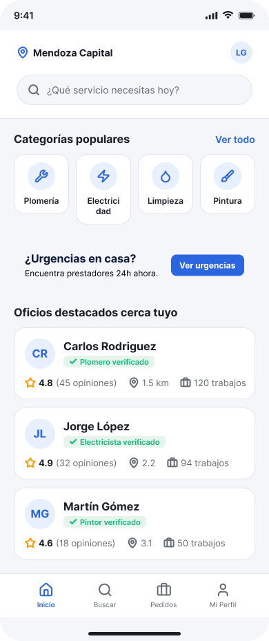
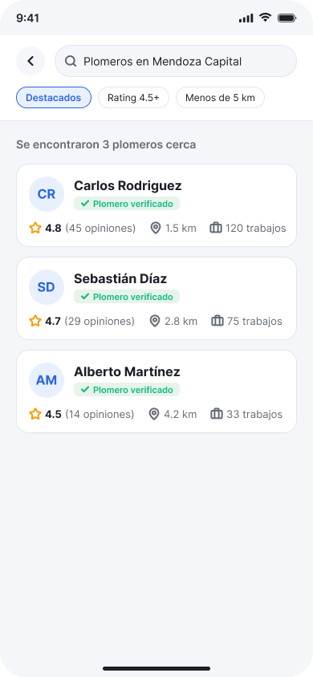

# OficiosYa

## Evaluacion Global Integradora

**Carrera:** Tecnicatura Universitaria en Desarrollo de Software  
**Espacio curricular:** Programacion de Aplicaciones para Celulares  
**Modalidad:** Individual  
**Estudiante:** Brandon Luna 
**Repositorio:** https://github.com/BrandonLunaCastro/OficiosYA

---

# I. Planteamiento y justificacion del problema

## Problema real

En la provincia de Mendoza, muchas personas necesitan contratar servicios de plomeria, electricidad, mecanica, pintura, gas u otros oficios. Sin embargo, la busqueda suele depender de recomendaciones informales, mensajes privados o publicaciones dispersas. Esto dificulta comparar prestadores, conocer su ubicacion, verificar su reputacion y guardar de forma organizada las solicitudes realizadas.

El problema es concreto: un cliente necesita encontrar rapidamente un profesional cercano y confiable, mientras que un prestador independiente necesita publicar sus servicios y construir una reputacion digital que le permita conseguir nuevos trabajos.

## Usuario destinatario

**Cliente:** personas que necesitan contratar una solucion domiciliaria. Principalmente, usuarios que buscan velocidad, cercania y referencias antes de decidir. El perfil representativo es Martin Gonzalez, empleado administrativo de 28 años, que necesita localizar un profesional cercano y solicitar un presupuesto.

**Prestador:** profesionales independientes de Mendoza que ofrecen servicios domiciliarios. El perfil representativo es Carlos Rodriguez, mecanico independiente de 42 años, que necesita mostrar su experiencia, ubicacion, datos de contacto, servicios y valoraciones.

## Justificacion

OficiosYa responde a un problema real, propio. La aplicacion sirve como intermediario de informacion entre ambas partes sin depender de una conversacion aislada para comenzar la busqueda.

El usuario puede:

- explorar categorias de oficios;
- buscar por texto, categoria, valoracion y distancia;
- consultar un perfil profesional;
- solicitar un presupuesto;
- consultar los pedidos creados durante la sesion;
- ver los datos de contacto del prestador;
- editar el perfil propio;
- registrar datos profesionales, cobertura, servicios y valoraciones.

El prestador puede:

- elegir su rol y completar el perfil inicial;
- editar su informacion profesional;
- agregar y modificar servicios;
- informar su ubicacion y datos de contacto;
- consultar su perfil, contacto y valoraciones.

La solucion transforma una busqueda informal en un recorrido claro dentro de la aplicacion: elegir, comparar, consultar y solicitar.

---

# II. Diseno de la aplicacion

## Flujo de navegacion

```text
Splash
  -> Onboarding
       -> Inicio de sesion
            |
            |-- Cuenta demo cliente
            |     -> Inicio del cliente
            |          -> Editar perfil
            |          -> Busqueda / filtros
            |               -> Perfil del prestador
            |                    -> Solicitar presupuesto
            |          -> Pedidos
            |               -> Datos de contacto del prestador
            |
            |-- Cuenta demo prestador
                  -> Mi perfil profesional
                       -> Editar perfil
                       -> Servicios
                       |    -> Agregar o editar servicio
                       -> Pedidos de clientes
                       |    -> Datos y contacto del cliente
                       -> Ubicacion y contacto
                       -> Resenas
```

El flujo esta registrado centralmente en [app_router.dart](lib/routes/app_router.dart) y [app_routes.dart](lib/routes/app_routes.dart). La pantalla inicial es el Splash, declarado en [main.dart](lib/main.dart). El login mock identifica el rol por las credenciales y abre directamente el inicio correspondiente; no vuelve a solicitar la carga inicial del perfil.

## Pantallas clave

### Splash y onboarding

Presentan la identidad de la aplicacion y explican el funcionamiento basico antes de acceder al inicio de sesion.


### Acceso y alta de cuenta

El prototipo incluye pantallas para elegir el rol y registrarse. En la version implementada, el inicio de sesion usa las cuentas mock de demostracion y dirige cada rol a su pantalla; el formulario de registro todavia no crea cuentas.


### Inicio del cliente

Presenta categorias, prestadores destacados, buscador y navegacion inferior.



La implementacion se encuentra en [client_home_screen.dart](lib/ui/screens/client_home_screen.dart).

### Busqueda y perfil del prestador

La pantalla de resultados permite combinar texto, categoria, valoracion y distancia. Desde cada tarjeta se accede al perfil y a la solicitud de presupuesto.




Las pantallas estan implementadas en [search_results_screen.dart](lib/ui/screens/search_results_screen.dart) y [provider_profile_screen.dart](lib/ui/screens/provider_profile_screen.dart).

### Pedidos y contacto

En el flujo del cliente, los pedidos muestran el servicio solicitado, el prestador y los datos disponibles. En el flujo del prestador, **Pedidos** abre la lista **Solicitudes de contacto** con los pedidos dirigidos al perfil activo. Cada tarjeta muestra el oficio, la fecha y el cliente; al tocar **Ver datos del cliente**, se abre una segunda pantalla con su teléfono y correo para iniciar una llamada o redactar un mensaje.


La implementacion corresponde a [orders_screen.dart](lib/ui/screens/orders_screen.dart) y [contact_info_sheet.dart](lib/ui/widgets/contact_info_sheet.dart).

La lista y el detalle de las solicitudes entrantes del prestador se implementan en [provider_orders_screen.dart](lib/ui/screens/provider_orders_screen.dart). Cada pedido conserva los datos de contacto del prestador para la vista del cliente y los datos del cliente para la vista del prestador.


### Funciones del prestador

El prestador puede consultar y editar su perfil, publicar servicios, actualizar ubicacion y contacto, y revisar valoraciones.


Las pantallas se encuentran en [professional_profile_screen.dart](lib/ui/screens/professional_profile_screen.dart), [provider_services_screen.dart](lib/ui/screens/provider_services_screen.dart), [provider_contact_screen.dart](lib/ui/screens/provider_contact_screen.dart) y [provider_reviews_screen.dart](lib/ui/screens/provider_reviews_screen.dart).


Las capturas de configuracion y contacto se conservan como referencia del diseño enviado, aunque muestran el campo WhatsApp. En la version implementada, los medios de contacto del prestador son telefono y correo electronico.

## Criterio visual

- **Color principal:** azul, utilizado en acciones, iconos y elementos activos.
- **Color secundario:** verde para estados verificados y confirmaciones.
- **Resenas:** estrellas amarillas para valoraciones.
- **Superficies:** tarjetas blancas con bordes suaves y fondo claro.
- **Tipografia:** tipografias heredadas de Flutter/Material, con jerarquia por peso y tamano.
- **Iconografia:** iconos Material que representan categorias, perfil, ubicacion, pedidos y contacto.
- **Consistencia:** botones principales reutilizables, barras de navegacion inferiores, tarjetas y campos de texto compartidos.

Los componentes visuales reutilizables incluyen [primary_button.dart](lib/ui/widgets/primary_button.dart), [provider_card.dart](lib/ui/widgets/provider_card.dart), [app_bottom_nav.dart](lib/ui/widgets/app_bottom_nav.dart), [custom_text_field.dart](lib/ui/widgets/custom_text_field.dart) y [search_bar_field.dart](lib/ui/widgets/search_bar_field.dart).

## Evidencia de diseno

- Prototipo Figma: https://www.figma.com/proto/V1CpKzNQsStl02izWPUUeK/OficiosYa?node-id=0-1&t=eueAPB3OV8UZe9wv-1
- Capturas de prototipo: [CapturasDiseño/Figma](CapturasDiseño/Figma/)
- Capturas ejecutadas en dispositivo o emulador: [CapturasDiseño/Dispositivo](CapturasDiseño/Dispositivo/)

---

# III. Implementacion practica

## Estado del desarrollo

La aplicacion fue desarrollada con **Flutter y Dart**. Incluye navegacion, modelos, repositorios, pantallas, widgets reutilizables y pruebas automatizadas. Las cuentas de demostracion permiten probar los flujos principales de cliente y prestador sin una base de datos.

## Cuentas mock para probar el inicio de sesion

El inicio de sesion valida credenciales locales de demostracion y carga el perfil asociado al rol. No utiliza una base de datos ni representa autenticacion segura para produccion.

| Rol | Correo | Contrasena |
|---|---|---|
| Cliente | `cliente@oficiosya.com` | `Cliente123` |
| Prestador | `prestador@oficiosya.com` | `Prestador123` |

Al autenticar una cuenta de cliente se abre el inicio del cliente; al autenticar una cuenta profesional se abre directamente su perfil. La seleccion de rol y el alta manual del perfil no se repiten al iniciar sesion.

## Funcionalidades implementadas

### Flujo general

- Splash y onboarding.
- Inicio de sesion con cuentas mock y validacion de credenciales.
- Carga automatica del perfil y acceso directo segun el rol de la cuenta.
- Navegacion principal mediante `MaterialApp` y rutas nombradas.

La autenticacion de demostracion esta en [mock_auth_repository.dart](lib/data/repositories/mock_auth_repository.dart); la interfaz de login, en [login_screen.dart](lib/ui/screens/login_screen.dart). La pantalla de registro es actualmente una maqueta y todavia no crea cuentas nuevas.

### Rol cliente

- Inicio con categorias y prestadores destacados.
- Busqueda por nombre, oficio o categoria.
- Filtros por valoracion minima y distancia.
- Visualizacion del perfil del prestador.
- Solicitud de presupuesto.
- Consulta de pedidos realizados durante la sesion.
- Edicion del perfil del cliente.
- Datos de cliente de demostracion precargados al iniciar sesion.
- Calificacion del prestador con estrellas y comentario opcional.

La logica de busqueda esta en [mock_provider_repository.dart](lib/data/repositories/mock_provider_repository.dart), y el registro de pedidos en [in_memory_order_repository.dart](lib/data/repositories/in_memory_order_repository.dart).

### Rol prestador

- Alta del perfil profesional.
- Edicion del perfil.
- Agregado y modificacion de servicios.
- Edicion de ubicacion y datos de contacto.
- Consulta de solicitudes recibidas con telefono y correo del cliente.
- Acciones para llamar al cliente o redactar un correo desde el pedido.
- Consulta de la ficha profesional.
- Consulta de promedio, distribucion y reseñas.
- Edicion de servicios y medios de contacto mediante formularios validados.

El perfil del prestador se carga al iniciar sesion; la edicion se realiza desde **Editar perfil**. Los medios publicados son telefono y correo electronico.

Las operaciones se realizan mediante interfaces de repositorio y implementaciones mock en [lib/data/repositories](lib/data/repositories/).

## Reutilizacion y organizacion del codigo

El proyecto se divide en:

```text
lib/
├── main.dart
├── routes/       # rutas y registro de pantallas
├── models/       # datos de la aplicacion
├── data/
│   ├── mocks/    # datos ficticios
│   └── repositories/ # acceso a datos mediante contratos
└── ui/
    ├── screens/  # pantallas
    └── widgets/  # componentes reutilizables
```

Los nombres de clases, archivos y metodos describen su responsabilidad. Por ejemplo, `ProviderProfileScreen`, `SearchResultsScreen`, `MockProviderServiceRepository` e `InMemoryOrderRepository`.

Los repositorios permiten reemplazar las implementaciones mock por una base de datos sin modificar las pantallas que dependen de sus contratos. Esto separa la interfaz, los datos y la logica.

## Persistencia y datos

En esta version no se usa SQLite ni una base remota. Los datos mock y los cambios realizados durante la ejecucion se mantienen en memoria:

- servicios y perfiles compartidos entre pantallas;
- contacto profesional compartido;
- pedidos creados desde el perfil del prestador;
- perfil del usuario en memoria.

Los datos se pierden al cerrar o reiniciar la aplicacion. Esta decision permite probar todos los recorridos sin depender de un servicio externo.

## Ejecucion

```bash
git clone https://github.com/BrandonLunaCastro/OficiosYA.git
cd OficiosYA
flutter pub get
flutter run
```

Para ejecutar las pruebas:

```bash
flutter test
```

La suite cuenta con 33 pruebas verificadas, incluyendo autenticacion mock, onboarding, perfiles, pedidos, prestadores, servicios, valoraciones y contacto. La compilacion web tambien fue verificada.

## Control de calidad y GitHub

- Repositorio: https://github.com/BrandonLunaCastro/OficiosYA
- Rama principal: `main`.
- El historial incluye tareas descriptivas de estructura, repositorios, estado de pedidos y pantallas.
- El repositorio tiene acceso publico para que el docente pueda revisar el codigo.

---

# IV. Analisis critico

## Interfaz declarativa

Flutter utiliza interfaces declarativas: el widget `Scaffold` describe su estructura y los metodos `build` describen que debe mostrarse segun el estado actual. Por ejemplo, [client_home_screen.dart](lib/ui/screens/client_home_screen.dart) combina `SearchBarField`, `CategoryItem`, `UrgencyBanner`, `ProviderCard` y `FutureBuilder`.

La ventaja es que la interfaz se define a partir de datos y estado, sin instrucciones manuales complejas para crear y modificar elementos. El costo es que el estado debe reconstruir correctamente el conjunto de widgets para no mostrar datos inconsistentes.

## Arquitectura de widgets

La aplicacion combina widgets sin estado, como `PrimaryButton`, con widgets con estado, como `SearchResultsScreen` y `OnboardingScreen`. El conjunto se organiza en pantalla y componentes reutilizables.

El repositorio central de rutas crea las pantallas e inyecta sus repositorios. De este modo, [app_router.dart](lib/routes/app_router.dart) evita que las pantallas creen directamente sus propias fuentes de datos.

Como ventaja, existe separacion entre interfaz, datos y navegacion. Como limitacion, el codigo presenta algunas pantallas extensas y podria extraerse mas logica a widgets y servicios para reducir su complejidad.

## Gestion de estado

`StatefulWidget` se usa para datos que cambian durante la navegacion:

- filtros y resultados en [search_results_screen.dart](lib/ui/screens/search_results_screen.dart);
- pagina activa del onboarding en [onboarding_screen.dart](lib/ui/screens/onboarding_screen.dart);
- navegacion inferior y perfil profesional;
- seleccion de pagina y estado de guardado.

Se utiliza `setState` para actualizar filtros, seleccion de rol, pestanas y formularios. El repositorio compartido mantiene datos profesionales y pedidos entre varias pantallas.

La ventaja es que el mecanismo es simple y apropiado para pantallas de alcance acotado. La limitacion es que no existe un estado global completo ni una solucion reactiva avanzada; al crecer la aplicacion, `setState` y repositorios singleton podrian volverse mas dificiles de coordinar.

## Asincronia

Las operaciones de repositorio utilizan `Future` y `async`:

- `getProviders()` y `searchProviders()` cargan prestadores;
- `getOrders()` obtiene pedidos;
- `createOrder()` registra una solicitud;
- `getReviews()` y `addReview()` consultan y agregan valoraciones;
- `getServices()`, `addService()` y `updateService()` administran servicios.

Las pantallas usan `FutureBuilder` para mostrar carga, datos o errores. Por ejemplo, [search_results_screen.dart](lib/ui/screens/search_results_screen.dart) mantiene un `_resultsFuture`, lo reemplaza al cambiar filtros y renderiza el resultado segun `snapshot`.

La ventaja es que las operaciones pueden representar servicios futuros sin bloquear la interfaz. La limitacion es que los repositorios actuales resuelven inmediatamente, por lo que no se simula latencia real ni recuperacion ante fallos de red. La vista de pedidos del prestador filtra las solicitudes por el nombre del perfil acti

## Persistencia

La persistencia actual utiliza listas en memoria dentro de implementaciones como [in_memory_order_repository.dart](lib/data/repositories/in_memory_order_repository.dart) y [mock_provider_service_repository.dart](lib/data/repositories/mock_provider_service_repository.dart).

Esta solucion permite:

- compartir cambios entre pantallas;
- conservar pedidos y servicios mientras la aplicacion sigue abierta;
- desarrollar sin configuracion externa;
- mantener contratos preparados para una futura implementacion real.

Sin embargo, tiene limitaciones profesionales importantes:

- los datos desaparecen al cerrar la aplicacion;
- la autenticacion es solo mock y no gestiona usuarios reales;
- no hay respaldo remoto;
- no hay sincronizacion entre dispositivos;
- no hay actualizacion en tiempo real;
- los datos de prestadores son ficticios;
- las solicitudes se comparten solo durante la sesion;
- las cuentas de prueba estan predefinidas y el formulario de registro aun no crea cuentas.

## Ventajas tecnicas

- Interfaz construida con widgets reutilizables.
- Separacion por modelos, repositorios, rutas y pantallas.
- Navegacion coherente y util en ambos roles.
- Busqueda con varios criterios combinables.
- Cambios compartidos durante la sesion.
- Solicitudes visibles para el prestador destinatario, con acceso al contacto del cliente.
- Manejo visual de carga y errores mediante `FutureBuilder`.
- Pruebas de repositorios y pantallas.
- Identidad visual consistente en la paleta, tipografia e iconos.

## Limitaciones y mejoras

1. **Persistencia:** reemplazar repositorios mock por SQLite, Hive o una API remota.
2. **Autenticacion:** agregar cuentas reales, sesiones persistentes y permisos.
3. **Datos:** validar datos reales de prestadores, DNI, matriculas y ubicacion.
4. **Estado:** incorporar Provider, Riverpod o BLoC si la aplicacion crece.
5. **Errores:** mejorar validaciones, estados vacios y reintentos ante fallos.
6. **Imagenes:** reemplazar miniaturas y avatares simulados por imagenes reales.
7. **Logica de contacto:** completar las acciones de llamada y correo en todos los flujos; desde los pedidos entrantes del prestador ya se pueden iniciar.
8. **Pruebas:** agregar mas pruebas de navegacion, busqueda y casos sin datos.
9. **Arquitectura:** dividir pantallas grandes y extraer validaciones y mapeos.

## Conclusion

La aplicacion demuestra la relacion entre interfaz declarativa, arquitectura de widgets, gestion de estado, asincronia y persistencia dentro de un problema real. El principal logro tecnico es que las pantallas dependen de contratos de repositorio y pueden mostrar datos mock sin conocer su almacenamiento concreto. Las cuentas demo permiten probar los flujos de ambos roles, incluyendo pedidos entrantes del prestador y calificaciones, sin solicitar la carga manual del perfil en cada inicio.

Como mejora prioritaria, se incorporaria persistencia real y autenticacion. Estas ampliaciones convertirian el prototipo funcional en una aplicacion util para usuarios reales y permitirian mantener perfiles, pedidos y servicios entre ejecuciones.

---

# Lista de control

- [x] Completar nombre y apellido del estudiante.
- [x] Se indica la tematica y el problema real.
- [x] Se distingue al usuario destinatario.
- [x] Se presenta el flujo de navegacion completo.
- [x] Se muestran las pantallas clave y el criterio visual.
- [x] La aplicacion tiene Flutter y esta organizada en widgets reutilizables.
- [x] El repositorio de GitHub esta incluido.
- [x] El analisis relaciona los conceptos con el codigo propio.
- [x] Se indican ventajas y limitaciones.
- [ ] Entregar este documento como PDF, Markdown o procesador de textos por el campus virtual.
